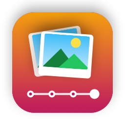

<p align="center"></p>

# Album Importer

**Add a folder of photos and videos to a date-based library, safely.** Drop a folder in, and
Album Importer reads the photos' own dates, names the album `YYYY-MM – Event`, picks the right
year folder, checks which files are already in the library, and copies the rest. Every copy is
checked byte for byte.

Your library is one folder of year folders (`2017 - 2020`, `2021 - 2022`, …), each holding albums
named by date, so sorting by name in Finder gives a timeline. Every import is recorded: one run
folder per import, a timeline spreadsheet and a daily history file.

## What it does

1. **Reads the folder (read-only).** Counts photos, videos and audio; reads each file's date from
   the camera data (EXIF), the video's own metadata, Google Takeout notes or the file name; notes
   the camera; drops camera folders such as `DCIM/100CANON` or `DJI/100MEDIA`.
2. **Suggests the album:**
   - **Name:** `2022-07 – Beach Trip`, or `2022-07 to 2022-09 – …` for a range. The event comes
     from the folder name with dates removed; a camera name like `EOS` is never used. Special dates
     (New Year's Eve, plus birthdays and anniversaries you add in Settings) can name an album on
     their own. Personal dates are stored only in the settings on your Mac, never in the code.
   - **Year folder:** read from the drive each time, so a new `2027 - 2028` folder is picked up
     automatically. If no folder covers the date, it suggests one in the same style.
   - **Nearby albums** (e.g. "Family Dinner, the next day"), in case it's the same event; you can put
     the new album inside an existing one.
3. **Finds duplicates.** Every file is compared with the whole library by name and size, including
   the files inside zips. **Check Contents Too** reads the files to confirm matches and to find copies
   saved under another name (zip entries are compared by their stored CRC).
4. **Copies, after you confirm:**
   - A dry run checks every step first: nothing will be overwritten, folders exist, enough space.
   - Locked year folders are only unlocked with your permission, then locked again; both are logged.
   - One file is copied first and checked (the pilot), then the rest.
   - Each copy is compared with its original (SHA-256) and keeps the original's dates.
   - It **never deletes, moves or overwrites anything.** There is no code for it.
5. **Keeps the records:** `runs/NN_import_<event>/` with `plan.json`, `plan.csv`, logs, `lock_log.csv`
   and `run_report.md`; a new row in the timeline sheet (`sheets/timeline.xlsx` by default; backed up first, in date
   order, same formatting, "By year" formulas stretched); a section in `HISTORY_<date>.md`.

## What it doesn't do (yet)

- Find copies that were resized or recompressed (WhatsApp, Google "storage saver"): their bytes differ.
- Merge into an existing album file by file; it can only add the new album as a subfolder of one.
- Rename or move albums already in the library, extract zips, or split mixed folders.
- Suggest place names from GPS.
- Delete the originals. That stays your job, by design.

## Requirements

- A Mac with **macOS 26** or later
- **Xcode 26** or later (Swift 6.2), to build it. Tested with Xcode 27.1.

## Build and run

```sh
cd album-importer
scripts/build-app.sh
open "build/Album Importer.app"
```

Copy `build/Album Importer.app` to Applications if you like. It isn't from the App Store, so the
first time, open it with right-click → Open. macOS asks once for access to removable volumes and
the Documents folder.

**Settings** (⌘,) holds the locations. They're only starting points; choose any folder or drive:

| Setting | Default |
|---|---|
| Photo library | `~/Pictures/Albums` |
| Records folder | `~/Documents/Album Importer` |
| Timeline sheet | `sheets/timeline.xlsx` (inside the records folder) |

The drive icon under the sidebar shows whether the library is ready: green when it is, yellow while
it's getting ready, orange when something needs attention (hover or click it to see what), red when
the drive isn't connected.

## When a drive is full: switching libraries

Click the library name at the bottom of the sidebar (or **File → Choose Library…**, ⇧⌘L) to switch to
a library used before or to **Choose Another Drive or Folder…**. A new, empty folder opens the year
folder setup straight away.

- **Free space** is shown under the library name. A folder that won't fit is blocked before copying,
  with a button to choose another library; a warning appears when a copy would leave the drive
  nearly full (under 5%).
- **Duplicates across drives:** libraries used before are remembered (Settings → Other libraries), and
  their saved indexes are checked too, even when that drive isn't plugged in. A photo already on the
  full drive is still recognised when you import to the new one. Files inside zips can
  even be confirmed by contents without the drive (from the zip's stored checksum).
- **Drives plugged in or removed** are noticed straight away; folders that couldn't be checked
  without the library are checked again automatically. **Check Again** looks right away.
- Records stay in the same records folder; each timeline row's notes name the drive it was copied to.

## Starting a new library, or adding year folders

Point **Photo library** at a new folder (it can be one that doesn't exist yet, on any drive).

**Don't know the years yet?** Don't create a placeholder folder. Add your photo folders first (they
are only read), then open **File → Set Up Year Folders…** (⇧⌘Y). It lists the years your albums
start in, with album counts and sizes, and suggests ranges in one of three styles:

- **One per year:** a folder for each year that has albums.
- **Blocks of years:** equal blocks (2–10 years) from the earliest year, skipping empty blocks.
- **Balanced by size:** neighbouring years grouped so each folder holds a similar amount; quiet years
  share a folder, busy years get their own (e.g. `2003 - 2011` next to `2021 - 2022`).

Suggestions never overlap existing year folders. Edit any range, press Create, and the waiting albums
move to their folders. Or pick ranges by hand:

- **Quick fill:** from one year to another in blocks of 1–10 years (e.g. 2003–2026 by 2).
- **Add Range:** one range at a time, e.g. `2027 - 2028`; a single year makes a folder named `2027`.

Overlapping ranges are refused. The folders are created (with the library folder, if needed),
locked if you choose, and logged in a `runs/NN_year_folders/` folder. Existing folders are never
renamed or touched. A new records folder gets its own timeline sheet with the first import.

The same from the command line: `albumctl year-folders 2027-2028 2029 --execute`.

## Try it safely first

```sh
swift scripts/make-demo-library.swift /tmp/album-demo
```

This builds a throwaway library (year folders, some Locked), a records folder and three source
folders (a camera card, a drone dump, a phone export). Point Settings at
`/tmp/album-demo/Photo Library` and `/tmp/album-demo/Records`, then drop folders from
`/tmp/album-demo/Sources`. Copy a timeline sheet into `Records/sheets/` to see it updated.

## Command line

The same engine is in `albumctl` (also inside the app at `Contents/MacOS/albumctl`):

```sh
albumctl scan "/Volumes/Camera Card/EOS"                                   # review, read-only
albumctl import "/Volumes/Camera Card/EOS" --event "Weekend at Home"       # plan + dry run only
albumctl import "/Volumes/Camera Card/EOS" --event "Weekend at Home" --allow-unlock --execute
albumctl index --full                                                    # rebuild the duplicate index
albumctl year-folders 2027-2028 --execute                                # add a year folder
```

Options: `--library`, `--records`, `--timeline`, `--year-folder "2027 - 2028"`, `--contents` (check contents too).

## Project layout

| Path | What it is |
|---|---|
| `Sources/AlbumCore` | The engine: scanning and dates (`SourceScanner`, `DateReader`), naming (`Naming`), year folders and locks (`YearFolders`, `YearFolderSetup`), duplicate index (`LibraryIndex`, `ZipReader`, `Duplicates`), plan and dry run (`Plan`), copying (`Executor`), the whole run (`ImportJob`), records (`Records`, `TimelineSheet`, `XLSX`) |
| `Sources/AlbumImporter` | The SwiftUI app |
| `Sources/albumctl` | The command-line tool |
| `Tests/AlbumCoreTests` | Tests on throwaway folders, including a full locked-folder import |
| `scripts/` | `build-app.sh`, `make-icon.swift`, `make-demo-library.swift` |

```sh
swift test
# Also check the timeline update against a copy of a real sheet (the original isn't touched):
ALBUM_TIMELINE_XLSX=".../timeline.xlsx" ALBUM_TIMELINE_OUT=/tmp/timeline-test.xlsx swift test --filter RealTimeline
```

The duplicate index is a cache in `~/Library/Application Support/Album Importer/`, one file per
library. A refresh only re-lists folders whose modified date changed.

## License

[MIT](LICENSE) © Kushagra Sinha
